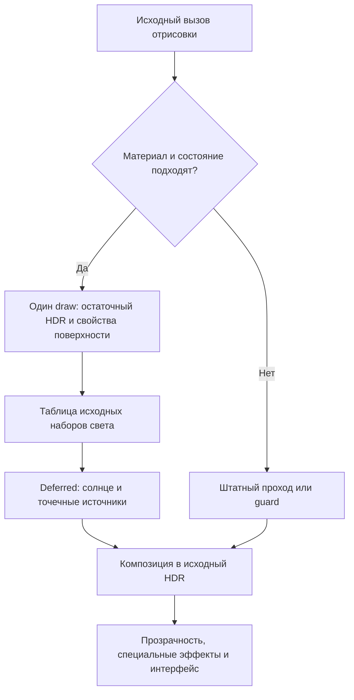

# Deferred для Spider-Man: Web of Shadows

Документация установленной версии, 9 сентября 2026 года, сборка с GPU-профилировщиком. План следующих работ: [ROADMAP_RU.md](<B:/Games/Spider Man - Web of Shadows/WoS_Deferred/full_deferred_staged/ROADMAP_RU.md>).

## Состояние релиза

Установлен рендерер `primary_geometry`: поддержанная непрозрачная геометрия рисуется один раз, свойства поверхности записываются одновременно с остаточным освещением, затем прямой свет вычисляется отдельным проходом. Повторная отправка той же геометрии для построения G-buffer удалена.

| Параметр | Подтверждённое состояние |
|---|---|
| Платформа | Исследованный x86 EXE, Direct3D 9 / Shader Model 3 |
| Материалы | 121 точный вариант, 17 пакетов, 370 файлов assets |
| Архивы GAME/MEGACITY | 115 из 115 обычных программ прямого света перенесены; 2 специальных прохода сохранены |
| Установленная DLL | `b24e6e5e31ab48fb06292156b6a658f4e1bfe7a150bdfc7aee5033414fb56c34` |
| Предыдущие DLL | `08a69ccf…` в копии от 00:25, `c49dfd37…` от 23:28, `70237ccf…` от 22:46, `6cb89ef5…` от 21:42, `064c1cad…` от 21:20, `0070c561…` от 21:10, `4a4d5038…` от 21:01, `0c2dbfd5…` от 20:40, `28fb49aa…` (релиз без профилировщика) от 20:14 |
| Манифест assets | `a58c75b710948e1dd7f0ee22b864edb8cad317661a4b31d22fabd749d2a98871` |
| EXE | `75231c20ea5521e1ec714ef7cb50469bf3d5169c63d1f489fa7fdf3c01b6d345`, не изменён этой установкой |
| Последняя игровая проверка | 1920×1080, RTX 3060, ошибок рендерера 0, geometry replays 0; на сборке `0c2dbfd5…` также сбоев 0, интервал кадра сошёлся с частотой Present |
| Текущая сборка в игре | Не запускалась после установки. Сборки `4a4d5038…`, `0070c561…`, `064c1cad…`, `6cb89ef5…` и `70237ccf…` измерены в уличных сценах, см. ROADMAP_RU.md |

Шесть вариантов в пакете не входят в эти 115 архивных программ, включая варианты PCSS. Число 121 не означает 121 тип объекта и не доказывает корректность всех миссий и состояний игры.

Отличие этой сборки от релиза `28fb49aa…`: опциональный GPU-профилировщик с переключателями, дополнительные CPU-счётчики, счётчики state blocks и две оптимизации P1: реестр наборов света на хэш-таблице с кэшем последнего попадания вместо дерева с 512-байтными сравнениями, отказ от захвата/установки/восстановления viewport и scissor вокруг primary-вызова (D3D9 сбрасывает их только при смене цели с индексом 0, которую рантайм не трогает), и теневая копия состояний для проверки eligibility. Обмен набора на ID и состояние устройства вокруг вызова остаются побайтно теми же. Кроме того, resolve умеет экранные контактные тени (выключены по умолчанию); при выключенных тенях шейдер идёт прежней веткой, что подтверждено побайтными сравнениями пикселей в runtime-наборе.

Тень состояний ([deferred_state_shadow.h](<B:/Games/Spider Man - Web of Shadows/WoS_Deferred/full_deferred_staged/deferred_state_shadow.h>)) заменяет ~19 вызовов Get на каждый вызов отрисовки чтением из копии, которую обновляют перехваты SetRenderState, SetViewport, SetRenderTarget, SetDepthStencilSurface и SetPixelShader. Apply state block, EndStateBlock и Reset сбрасывают копию целиком; во время записи state block обновления не принимаются. Каждая 64-я проверка сверяет копию с реальным устройством; одно расхождение выключает тень до конца сеанса и увеличивает `mismatches` в статусе. Неизвестная или выключенная тень означает реальный Get, поэтому корректность от неё не зависит. Переключатель `[Cache] Eligibility` в settings.ini, `--eligibility-cache 0|1` в control.py и флажок в меню. Материалы, формулы света, G-buffer и границы совместимости не менялись: все 370 файлов assets совпадают с прежними побайтно. Профилировщик выключен по умолчанию и при выключенном состоянии не создаёт ни одного объекта D3D.

Источники состояния: [итог игрового теста](<B:/Games/Spider Man - Web of Shadows/WoS_Deferred/full_deferred_staged/live_validation/primary_final/validation.json>), [установленные файлы](<B:/Games/Spider Man - Web of Shadows/WoS_Deferred/full_deferred_staged/primary_release/installed_verification.json>), [текущая запись установки](<B:/Games/Spider Man - Web of Shadows/WoS_Deferred/full_deferred_install.json>), [архивное покрытие](<B:/Games/Spider Man - Web of Shadows/WoS_Deferred/full_deferred_staged/primary_release/archive_coverage.json>).

## Как проходит кадр



Схема упрощена: завершение накопленного света выполняется на необходимых границах проходов. Неизвестный opaque-материал может рисоваться один раз через guard, сохраняющий native RGBA и помечающий затронутые пиксели как не участвующие в deferred. Несовместимые состояния завершают накопленный свет перед штатной отрисовкой.

### Буферы и свет

| Поверхность | Содержимое |
|---|---|
| RT0 — существующий HDR игры | RGB: остаточное освещение, отражения и эмиссия после удаления заменяемого прямого света; A: точная исходная альфа |
| RT1 — normal/shadow/set | XY: octahedral normal; Z: видимость солнечного света; W: идентификатор набора света |
| RT2 — diffuse/fog | RGB: native diffuse coefficient `rho`; A: пропускание тумана |
| RT3 — specular/power | RGB: коэффициент блика; A: параметр исходной степени блеска |
| INTZ игры | Исходная глубина, записанная тем же единственным draw |
| Таблица света | Направленный свет и до 8 точечных источников в наборе |

RT1–RT3 и временный результат resolve используют RGBA16F. RT0 не является дополнительной копией геометрии. Resolve сохраняет непокрытые пиксели, рассчитывает покрытые и возвращает результат в исходный HDR.

Положительные ID 1–1023 означают валидный набор света. Значение 0 означает нетронутый пиксель, −1 — пиксель с исходным результатом, который нельзя повторно осветить. При заполнении таблицы накопленный batch сначала завершается. Эти ID нельзя менять без обновления шейдеров и GI adapter.

Освещение использует GGX/Smith/Schlick с адаптацией из Filament. Коэффициенты WoS сохраняют художественный масштаб исходной игры; физически откалиброванные F0, roughness и яркость источников не заявляются. Лицензия и версия источника находятся в [third_party/filament](<B:/Games/Spider Man - Web of Shadows/WoS_Deferred/full_deferred_staged/third_party/filament>).

Нативные точечные источники часто обрабатываются парами. Runtime учитывает это в CPU-таблице: ограничивает число размером native массива и при необходимости читает реальный дополнительный слот пары. GPU-константы игры не переписываются. Некорректные данные приводят к штатной обработке, а не выдуманному источнику.

### Альфа, GI и границы совместимости

Сохраняются исходная alpha-test логика, texkill и запись глубины. Body/blend оставляют ту часть исходной арифметики света, от которой зависит альфа. Она не используется для повторного расчёта RGB поверхности.

Metallic переводится на один GGX-блик. Дополнительный штатный художественный блик и связанные перекрёстные слагаемые удалены из заменяемой части света. Остаточные отражения, эмиссия, thin-film вклад и альфа сохраняются в рамках проверенного контракта материала.

GI получает normal/rho через adapter, который объединяет результаты batches за кадр и удаляет приёмники света на пикселях guard. Для сцены, которой уже владеет primary, нельзя незаметно подставлять старую карту legacy GI. Базовая GI-система существовала до этого перехода; она не равнозначна новой полноценной многократной трассировке света.

Два специально сохранённых прохода:

- `2328ce89…`: преломление, читающее framebuffer.
- `f1eba45f…`: проекционная декаль, читающая глубину. При blended-декали GI использует материал базовой поверхности.

Прозрачность, FX и неподдержанные состояния сохраняют штатную обработку. Проверены обычные барьеры RT/depth/StretchRect; любой новый способ чтения/копирования сцены требует отдельного подтверждения. При ошибке resolve после записи residual нельзя обещать восстановление всего текущего кадра штатным светом. При повреждённом состоянии устройства новые вызовы блокируются до Reset. Это важные ограничения дальнейших изменений.

## Настройки и диагностика

Настройки находятся в [settings.ini](<B:/Games/Spider Man - Web of Shadows/WoS_Deferred/full_deferred/settings.ini>). Последний снимок: Deferred ON, Intensity 2.242, Specular 0.173, View 0; GI OFF, Bounce 1.5, Ambient 0, Radius 20, Distance 400; профилировщик ON (включён во время первого живого запуска). Это пользовательский выбор на момент документации, не значения, которые нужно принудительно восстанавливать при обновлении.

| View | Режим |
|---|---|
| 0 | Обычный результат |
| 1 | Новый прямой свет на покрытых пикселях |
| 2 | Зелёная диагностическая отметка покрытия |
| 3 | Направления нормалей |
| 4 | Маска контактной тени: белое освещено, тёмное перекрыто |

Диагностические режимы не перекрашивают весь кадр: непокрытые поверхности и поздние проходы могут оставаться штатными. Все режимы пишут результат в HDR-цель игры, после чего он проходит тонмаппинг и автоэкспозицию, поэтому яркость на снимке нельзя читать как значение маски; сравнивать режимы между кадрами тоже нельзя, потому что включение затенения само сдвигает автоэкспозицию.

Для следующих команд в PowerShell сначала задать путь:

```powershell
$stagePath = 'B:\Games\Spider Man - Web of Shadows\WoS_Deferred\full_deferred_staged'
```

Снимок кадра и короткая статистика при запущенной игре:

```powershell
python "$stagePath\control.py" --capture
python "$stagePath\control.py" --warmup-seconds 2 --sample-seconds 5
```

Просмотр покрытия и возврат к обычному изображению:

```powershell
python "$stagePath\control.py" --view 2 --capture
python "$stagePath\control.py" --view 0
```

Профилировщик GPU. Включение сбрасывает окно статистики, чтобы прогрев не попал в измерение:

```powershell
python "$stagePath\control.py" --gpu-profiler 1 --gpu-profiler-reset
python "$stagePath\control.py" --gpu-profiler 1 --warmup-seconds 3 --sample-seconds 10
python "$stagePath\control.py" --gpu-profiler 0
```

Профилировщик размечает timestamp-запросами интервал primary-batch от открытия batch до входа в resolve, обе копии HDR вокруг resolve, сам resolve и слияние GI, а также полный интервал кадра между границами Present. Геометрия не размечается по вызовам: их около 2500 за кадр, и первая сборка на этом исчерпывала бюджет меток. Интервал batch включает и штатные вызовы между primary-отправками, его `calls` равен числу resolve batches. Этот интервал включает Present, вертикальную синхронизацию и простой, поэтому участки в него не суммируются и сравнивать его с CPU submission timers нельзя. Отчёт попадает в `full_deferred_status.json` объектом `gpu_profiler` со средним, медианой и p95 по каждому участку за окно из 256 завершённых кадров. Disjoint-окна и неполные результаты идут в `discarded_frames`, а не в измерение. Устройство без timestamp queries выставляет `supported=false` и рисует как прежде. Снимки и трассы задерживают свой кадр, поэтому их не смешивают с окном измерения. Полный протокол: [CONTROL_API.md](<B:/Games/Spider Man - Web of Shadows/WoS_Deferred/full_deferred_staged/CONTROL_API.md>).

Контактные тени. Экранный march вдоль направления солнца по буферу глубины внутри resolve; глубина сравнивается в линейных единицах вида, результат объединяется с native-видимостью солнца через min. Затенение непрерывно: каждый шаг даёт вклад, нарастающий за порогом смещения и спадающий на пределе толщины, а марш берёт наибольший вклад вместо выхода по первому попаданию. Раньше решение было булевым, и периодичность джиттера превращалась в пилу по всей границе тени. Сила затемнения убывает с расстоянием от принимающей точки, а в полутени native-карты контактная тень не применяется, поэтому её край растворяется в native-тени, а не режет её. Секция `[Contact]` в settings.ini: `Enabled`, `Length` (мировые единицы, 0.05..10), `Thickness` (единицы вида, 0.01..10), `Steps` (2..32, по умолчанию 16), `Strength` (0..1), `Bias` (смещение старта по нормали, 0..1). Те же параметры доступны флагами `--contact-*` в control.py и ползунками в меню. Масштаб мира не откалиброван: длину и толщину подбирать по маске в view 4.

```powershell
python "$stagePath\control.py" --contact-enabled 1 --contact-length 0.5 --contact-thickness 0.5 --view 4
python "$stagePath\control.py" --capture
python "$stagePath\control.py" --view 0
```

Снимок в одном запросе со сменой настроек может показать предыдущий кадр; для проверки режим ставится отдельным запросом, снимок делается следующим.

Переключение рендерера или GI:

```powershell
python "$stagePath\control.py" --enabled 0
python "$stagePath\control.py" --enabled 1
python "$stagePath\control.py" --indirect-enabled 1
python "$stagePath\control.py" --indirect-enabled 0
```

GI переключается через существующий путь сброса F5. `--indirect-enabled` и `--reload-materials` нельзя объединять в одной команде. Полный протокол: [CONTROL_API.md](<B:/Games/Spider Man - Web of Shadows/WoS_Deferred/full_deferred_staged/CONTROL_API.md>).

Трасса одного кадра:

```powershell
python "$stagePath\control.py" --capture --trace
```

Снимки и ответы сохраняются в [diagnostics](<B:/Games/Spider Man - Web of Shadows/WoS_Deferred/full_deferred/diagnostics>), трассы — в [captures](<B:/Games/Spider Man - Web of Shadows/WoS_Deferred/captures>). Для анализа указать полученный каталог в `audit_primary_capture.py --capture ... --output ...`. Трасса должна иметь маркер END. Снимки и трассировка могут задерживать кадр, поэтому их не смешивают с контрольным FPS-замером.

В [full_deferred_status.json](<B:/Games/Spider Man - Web of Shadows/WoS_Deferred/full_deferred_status.json>), revision которого теперь 3, проверять `pipeline=primary_geometry`, `geometry_replays=0`, `failures`, `supported_draws`, `guard_draws`, `fallback_draws`, `resolve_batches`. Исторические поля `replay_*_cpu_ms` и `replay_calls` в этой версии учитывают отправку единственного primary draw; они не означают геометрический replay. Дополнительные CPU-поля: `find_cpu_ms` (поиск варианта, входит в eligibility), `bindings_cpu_ms` (проверка привязок перед вызовом), `lights_read_cpu_ms` (чтение констант света), `light_intern_cpu_ms` (интернирование набора света), `scope_release_cpu_ms` (освобождение ссылок после вызова). Объект `eligibility_cache` содержит `requested`, `enabled`, `status`, `hits` и `fills` за последний кадр, `verifications`, `mismatches` и `invalidations` накопительно; `mismatches` больше нуля означает, что какой-то путь изменения состояния не перехвачен, и тень себя выключила. Объект `contact` повторяет параметры контактных теней и считает `matrix_failures` — batches, где обратная камера не инвертировалась и тени были пропущены. Объект `state_blocks` накапливает с момента загрузки число CreateStateBlock, BeginStateBlock, EndStateBlock, Apply и Apply во время открытого batch; Apply считается по vtable первого увиденного state block. CPU submission и Present cadence не являются измерением GPU-времени.

## Сборка и установка

Рабочий каталог команд сборки — корень игры:

```powershell
Set-Location -LiteralPath 'B:\Games\Spider Man - Web of Shadows'
```

Текущий workflow использует primary-скрипты. Старые `assemble_assets.py`, `install.ps1` и `verify_install.py` относятся к предыдущей replay-версии.

1. При изменениях материалов обновить соответствующий генератор, reference и CPU/HAL-проверки. Внести готовый пакет в [primary_release_packs.json](<B:/Games/Spider Man - Web of Shadows/WoS_Deferred/full_deferred_staged/primary_release_packs.json>). При изменении runtime выполнить относящиеся к нему проверки, прежде чем пересобирать DLL.
2. Подготовить интеграцию и собрать x86 DLL:

```powershell
python "$stagePath\prepare_integration.py"
& "$stagePath\build_integration.ps1"
```

3. Собрать assets и проверить настоящий загрузчик:

```powershell
python "$stagePath\assemble_primary_assets.py"
python "$stagePath\tests\run_primary_release_loader.py"
python "$stagePath\verify_primary_install.py"
```

Каждая команда должна завершиться успешно; не продолжать после ошибки. Установщик обновляет запись установки через `File.Replace` с явным именем резервного файла: Windows PowerShell превращает `$null` в пустую строку, и без этого повторная установка поверх существующей записи прерывается с откатом. Нужны доступные Python, установленный MSVC x86 toolchain и D3D9 HAL для GPU-проверок. Скрипт сборки содержит конкретный путь Visual Studio этой машины; на другой системе его необходимо адаптировать.

4. Сохранить прогресс и закрыть игру. Проверить готовность и установить:

```powershell
& "$stagePath\install_primary.ps1"
& "$stagePath\install_primary.ps1" -Apply
```

Установщик не закрывает игру. Он создаёт backup, сохраняет settings, сверяет хеши и точный состав assets, затем заменяет DLL. После запуска нужно отдельно проверить игровой кадр. `installed=false` в preflight-файле означает проверку пакета, а не отсутствие установки; фактическое состояние записано в `full_deferred_install.json`.

### Добавление материалов без перезапуска

После новой assembly, проверки loader и preflight, если установленная DLL совпадает с проверенной:

```powershell
python "$stagePath\publish_primary_materials.py"
python "$stagePath\publish_primary_materials.py" --apply
```

Этот путь допускает только добавление файлов; уже установленные shader bytes должны совпадать. Все файлы публикуются до запроса `ReloadMaterials`. В памяти набор заменяется только после успешной проверки всех новых шейдеров. Publisher не заменяет DLL и не меняет settings. Для изменения существующих шейдеров использовать полную установку при закрытой игре либо отдельно разработанный и проверенный процесс замены.

При потерянном подтверждении полный опубликованный пакет сохраняется: неизвестно, успел ли runtime его принять. Смотреть `publish_receipt.json`: `publication_complete`, `reload_attempted`, `reload_acknowledged`, `phase`, `error`. Нельзя объявлять успешную живую загрузку только по наличию файлов на диске. Сбой до полной публикации тоже записывается в журнал.

### Откат

При закрытой игре:

```powershell
& "$stagePath\rollback.ps1"
& "$stagePath\rollback.ps1" -Apply
```

Текущий откат возвращает DLL `08a69ccf…` из [резервной копии](<B:/Games/Spider Man - Web of Shadows/WoS_Deferred/backups/full_deferred_20260910_002545_4f565267>): скрипт берёт каталог из `backup_directory` в текущей записи установки. Релиз без профилировщика `28fb49aa…` лежит в копии `full_deferred_20260909_201401_3324569c`; чтобы вернуться к нему, подставить этот каталог вручную. Вместе с ним возвращается старый settings.ini. Если нужно сохранить позднейшие настройки, сначала отдельно сохранить актуальный файл. Откат не удаляет текущие assets: они перемещаются в резервный каталог. Это полный откат к прежней replay-версии, не выборочное удаление последнего материала.

## Проверки и результаты

| Проверка | Подтверждено |
|---|---|
| Primary runtime | 20 сценариев, 2 311 799 проверок |
| GI provider | 12 сценариев, 1 196 проверок |
| Транзакционная перезагрузка | 14 сценариев, 8 199 проверок |
| Парная обработка источников | 827 случаев, 10 655 проверок |
| Control API | 74 parser case, 8 форматов, 402 проверки; CLI 14 |
| GPU-профилировщик | 40 измеренных кадров на реальном HAL, 646 проверок |
| Тень состояний | 10 сценариев на реальном HAL, 106 проверок |
| Финальный loader | 121 вариант, 726 exact lookups, 489 случаев неполных/неверных assets, 41 499 проверок |
| Публикация файлов | 6 тестов, включая частичную ошибку копирования и потерю ack |
| Аудитор трассы | 6 CPU-тестов |
| Материалы | 17 пакетов с собственными актуальными CPU/HAL receipts |

Точки входа тестов: `tests/run_primary_runtime_checks.py`, `run_primary_gi_provider_checks.py`, `run_material_reload_checks.py`, `run_paired_lights_checks.py`, `run_control_checks.py`, `run_gpu_profiler_checks.py`, `run_state_shadow_checks.py`, `run_primary_release_loader.py`, `test_primary_publisher.py`. Для материала использовать runner его конкретного пакета. Проверки сравнивают также alpha/depth, invalid-tag fallback, пиксели с разными ветвлениями внутри одного примитива. Не все проверки используют реальные игровые материалы: orchestration, algebra и live QA подтверждаются разными наборами доказательств.

Контрольная крыша: среднее 52.36 FPS с deferred и 97 FPS без него. Это около 19.1 и 10.3 мс на кадр при пересчёте средних FPS, не измерение GPU-времени. Финальные полётные samples 61/61/57 FPS получены в другой сцене. Старые 38–48 FPS replay-версии также сняты в другом месте: утверждать выигрыш по этому сравнению нельзя.

В последнем trace 4 429 из 4 429 подходящих по наблюдаемым полям вызовов с именованными direct-light inputs имеют точное соответствие пакету. Непокрытые записи без таких inputs не объявляются автоматически ошибкой. Аудит не измеряет видимые пиксели, все runtime gates или всю игру.

## Карта исходников

| Узел | Файлы |
|---|---|
| Перехват и жизненный цикл | [deferred_runtime.h](<B:/Games/Spider Man - Web of Shadows/WoS_Deferred/full_deferred_staged/deferred_runtime.h>), [prepare_integration.py](<B:/Games/Spider Man - Web of Shadows/WoS_Deferred/full_deferred_staged/prepare_integration.py>) |
| Сохранение native состояния | [deferred_primary_state.h](<B:/Games/Spider Man - Web of Shadows/WoS_Deferred/full_deferred_staged/deferred_primary_state.h>), [primary_guard_builder.h](<B:/Games/Spider Man - Web of Shadows/WoS_Deferred/full_deferred_staged/primary_guard_builder.h>) |
| Свет и пары | [deferred_lights.h](<B:/Games/Spider Man - Web of Shadows/WoS_Deferred/full_deferred_staged/deferred_lights.h>), [deferred_paired_lights.h](<B:/Games/Spider Man - Web of Shadows/WoS_Deferred/full_deferred_staged/deferred_paired_lights.h>) |
| Resolve и BRDF | [deferred_resolve.hlsl](<B:/Games/Spider Man - Web of Shadows/WoS_Deferred/full_deferred_staged/deferred_resolve.hlsl>), [deferred_brdf.hlsl](<B:/Games/Spider Man - Web of Shadows/WoS_Deferred/full_deferred_staged/deferred_brdf.hlsl>) |
| GI | [primary_gi_provider.h](<B:/Games/Spider Man - Web of Shadows/WoS_Deferred/full_deferred_staged/primary_gi_provider.h>), [gi_adapter.h](<B:/Games/Spider Man - Web of Shadows/WoS_Deferred/full_deferred_staged/primary/gi_adapter.h>) |
| Профилирование GPU | [deferred_gpu_profiler.h](<B:/Games/Spider Man - Web of Shadows/WoS_Deferred/full_deferred_staged/deferred_gpu_profiler.h>), [tests/gpu_profiler_test.cpp](<B:/Games/Spider Man - Web of Shadows/WoS_Deferred/full_deferred_staged/tests/gpu_profiler_test.cpp>) |
| Тень состояний | [deferred_state_shadow.h](<B:/Games/Spider Man - Web of Shadows/WoS_Deferred/full_deferred_staged/deferred_state_shadow.h>), [tests/state_shadow_test.cpp](<B:/Games/Spider Man - Web of Shadows/WoS_Deferred/full_deferred_staged/tests/state_shadow_test.cpp>) |
| Управление и reload | [deferred_control.h](<B:/Games/Spider Man - Web of Shadows/WoS_Deferred/full_deferred_staged/deferred_control.h>), [deferred_material_reload.h](<B:/Games/Spider Man - Web of Shadows/WoS_Deferred/full_deferred_staged/deferred_material_reload.h>), [control.py](<B:/Games/Spider Man - Web of Shadows/WoS_Deferred/full_deferred_staged/control.py>) |
| Выбор пакетов | [primary_release_packs.json](<B:/Games/Spider Man - Web of Shadows/WoS_Deferred/full_deferred_staged/primary_release_packs.json>), [assemble_primary_assets.py](<B:/Games/Spider Man - Web of Shadows/WoS_Deferred/full_deferred_staged/assemble_primary_assets.py>) |
| История | [STATUS_RU.md](<B:/Games/Spider Man - Web of Shadows/WoS_Deferred/full_deferred_staged/STATUS_RU.md>), [прежняя документация replay](<B:/Games/Spider Man - Web of Shadows/WoS_Deferred/full_deferred_staged/docs_history/README_REPLAY_20260909.md>) |

Старые checkpoints и `release/assets` сохраняют доказательства предыдущей архитектуры. Не смешивать их с `primary_release/assets` при подготовке новой установки. ReShade и ENB не используются.
